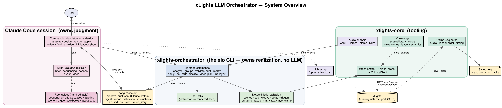
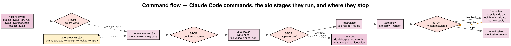
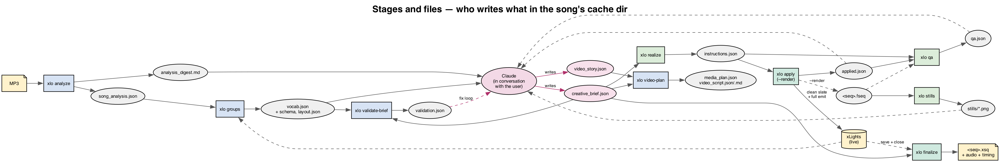
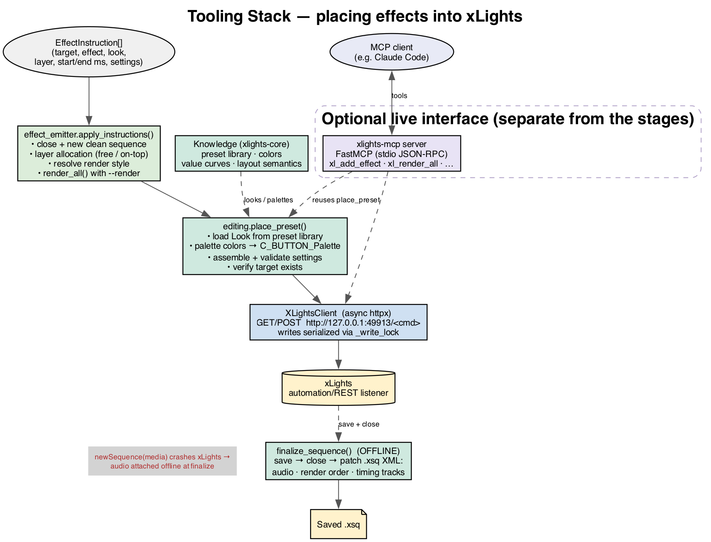

# Architecture

How the xLights LLM Orchestrator is put together: a Claude Code session that does the judgment,
the deterministic `xlo` stage commands that do the realization, the files between them, and the
tooling that drives xLights. Diagrams are committed as PNGs under [`diagrams/`](diagrams/),
rendered from the Graphviz `.dot` sources beside them (see
[Regenerating the diagrams](#regenerating-the-diagrams)).

- [The big picture](#the-big-picture)
- [The command flow](#the-command-flow)
- [Stages and files](#stages-and-files)
- [Skills, commands and guides](#skills-commands-and-guides)
- [Realization](#realization)
- [Calling tooling](#calling-tooling)
- [Cross-cutting concerns](#cross-cutting-concerns)
- [Regenerating the diagrams](#regenerating-the-diagrams)

---

## The big picture



The organizing principle: **Claude Code owns judgment** (what the song is, where its peak is, each
section's look and palette, what to change after watching) and **code owns realization** (timing
snapped to the beat grid, palettes → real settings strings, layering, render order, brightness,
sparsity, triggers). The seam between them is a set of files in the song's cache dir, above all
`creative_brief.json`: Claude writes it, code validates and realizes it. No package calls a model.

| Part | Responsibility |
| --- | --- |
| Claude Code session (`.claude/commands/xlo/`, `.claude/skills/xlo-*`) | The conversation with the user; reading the digest; writing and revising the brief and the video story; reading QA, stills and apply reports and turning them into proposals. |
| [`xlights-orchestrator`](../../packages/xlights-orchestrator) | The `xlo` stage CLI: digest, vocabulary, brief validation, deterministic realization (scenes, weave, beats, triggers, phrasing, faces, matrix text), QA, stills, finalize, video planning. No LLM dependency. |
| [`xlights-core`](../../packages/xlights-core) | The tooling: async REST client, audio analysis (VAMP/librosa/stems/lyrics), the mined effect-preset library, colors and value curves, layout semantics, the offline preview renderer. |
| [`xlights-mcp`](../../packages/xlights-mcp) | A FastMCP server exposing xLights read/edit operations as tools, for live work in a Claude Code session that the stages don't cover. Independent of the stages. |

---

## The command flow



```
/xlo:init-layout ──STOP before write──▶ (once per layout)

/xlo:analyze <mp3> ──▶ STOP: confirm structure
   xlo analyze, xlo groups
/xlo:design        ──▶ STOP: approve brief
   write creative_brief.json, xlo validate-brief (loop until ok)
/xlo:realize
   xlo realize, xlo qa  → findings as proposals
/xlo:apply         ──▶ STOP: watch it in xLights
   xlo apply [--render]
        │
        ├─ /xlo:review   (repeat as needed)
        │     xlo stills, xlo qa, ask the user, edit brief,
        │     xlo validate-brief, xlo realize, xlo apply  → STOP
        │
        └─ /xlo:finalize
              xlo finalize --name <seq>  → .xsq + audio + timing tracks

/xlo:video   (after design)  xlo video-plan --plan-only → write video_story.json → xlo video-plan
/xlo:show <mp3>              analyze → design (STOP) → realize → apply (STOP)
```

Each command is a short markdown prompt: which skills to load, which `xlo` commands to run
through Bash, which files to read afterwards, what to tell the user (in viewer language, never
JSON), and where to stop. Review is manual: the user watches and says what to change; there is no
automatic critic or judge loop.

---

## Stages and files



Every stage is file-in, file-out over the song's flat cache dir,
`$XLO_CACHE_DIR/orchestrator/<song-slug>--<hash>/` (the hash is the song's content hash). Stages
exit 0 on success, 1 when they refuse or fail, and 2 when a prerequisite file is missing (the
message names it and the stage that produces it). Because the state is files, a session can stop
anywhere and resume, and every stage can be run by hand.

```
MP3 ─▶ xlo analyze ──▶ song_analysis.json, analysis_digest.md ─────────┐
xLights ─▶ xlo groups ─▶ vocab.json, creative_brief.schema.json,        │
                         layout.json ──────────────────────────────────┤
                                                                         ▼
                                              Claude ─▶ creative_brief.json
                                                 ▲              │
                         validation.json ◀── xlo validate-brief ◀┘
                                                                │
                                   xlo realize ─▶ instructions.json
                                                                │
              xLights ◀── xlo apply [--render] ─▶ applied.json, <seq>.fseq
                                                                │
         xlo qa ─▶ qa.json        xlo stills ─▶ stills/NN-<label>.png
                                                                │
              xlo finalize ─▶ <show folder>/<seq>.xsq (+ audio, render order, timing tracks)

brief ─▶ xlo video-plan --plan-only ─▶ media_plan.json ─▶ Claude ─▶ video_story.json
     ─▶ xlo video-plan --matrix-size WxH ─▶ video_script.json + video_script.md
```

The full table of files, producers and consumers is in
[docs/usage.md](../usage.md#the-songs-cache-dir-file-contract).

Key contracts:

- **`analysis_digest.md`** (`pipeline/digest.py`): a bounded, human-readable rendering of the
  analysis (overview, energy arc, downbeat-snapped sections with energy and dominant stems, timed
  and repeated lyric lines, instrument entrances, harmony, mood). It is what Claude reads instead
  of the raw analysis; interpretation happens in conversation and lands in the brief's labels,
  `concept` and `key_moments`.
- **`vocab.json`** (`pipeline/vocab.py`): the brief's vocabulary for this song and layout:
  targetable groups (probed empirically on the live xLights), placeable and cellable effect types,
  scene ids, stems, colors, blend methods. `creative_brief.schema.json` is derived from it.
- **`creative_brief.json`** (`show_plan.ShowPlan`): the only judgment artifact.
- **`validation.json`** (`pipeline/validate_brief.py`): `{ok, errors: [{path, message, allowed}],
  warnings}`. Structured enough for Claude to fix the brief without a human in the middle.
- **`applied.json`**: per-instruction outcomes from the emitter (placed, layer, skip reason).
- **`qa.json`** (`qa/`): findings with `section_index`, severity, metric and, for the rendered
  checks, a plain-language `fix`. Advisory; nothing gates.

---

## Skills, commands and guides

```
.claude/commands/xlo/*.md      what to do, step by step       (thin prompts)
        │ load
.claude/skills/xlo-*/SKILL.md  what to know, and where to look (short, pointers)
        │ read
repo-root guides               the craft itself               (hand-editable, single source)
  xlights-sequencing-guide.md · xlights-effects-catalog.md · xlights-layering-rendering-guide.md
  xlights-scene-cookbook.md · xlights-trigger-cookbook.md · xlights-layout-semantics-spec.md
```

The skills never copy the guides; each says which guide to open for which decision, so an edit to
a guide reaches the next design without touching a skill. The scene and trigger cookbooks are also
parsed by the deterministic layers (`pipeline/scenes.py`, `pipeline/triggers.py`), so one file
steers both Claude and the code.

| Skill | Loaded by | Knowledge |
| --- | --- | --- |
| `xlo-brief` | design, realize, review | the brief's fields, treatments, fabric, scene casting, key moments, the validate loop, feedback patterns |
| `xlo-sequencing` | design, review | craft: effect families by moment, energy → intensity/treatment, palette and LED contrast |
| `xlo-scenes` | design, review | cookbook scenes, `scene_cast`, steering the trigger layer |
| `xlo-layout` | analyze, apply, init-layout | the `SEM_` vocabulary, the manifest, classifying props |
| `xlo-video` | video | the story rules and `video_story.json` |

---

## Realization

`xlo realize` (`pipeline/generate.py:generate_instructions_from_brief`) is deterministic: the same
brief, analysis and vocabulary always produce the same `instructions.json`. Per section, in order:

1. **Base rows**: a cast cookbook scene's stack table (`scene_id` + `scene_cast`,
   `pipeline/scenes.py`) or, freeform, one row per target group cycling `effect_family` and
   `effect_types`, kept by the energy coverage cap.
2. **Bed and peak fill**: ensemble washes under the features; the peak section gets the broadest
   coverage.
3. **Fabric** (`pipeline/weave.py:weave_from_brief`): the beat carrier and a sparse texture cell
   expanded across the real beat grid on the rhythm pool, from the brief's `fabric` knobs
   (carrier, alternation, cell beats, blend) or code defaults. Treatment decides whether it runs;
   an explicit carrier weaves under `pulse` and `feature` too.
4. **Beat and trigger layers** (`pipeline/beats.py`, `pipeline/triggers.py`): accents on the
   metric ring, the hero following a stem's onsets, curated cookbook triggers, key-moment flashes.
5. **Phrasing and composites**: legato/staccato soft edges, phrase-dynamics curves, the curated
   composite stack on the hero at the peak, counter-rotation.
6. **Show-wide passes**: singing faces (lip-sync from timed lyrics), matrix lyric captions, the
   treatment gate, the 4-layer clamp, and the wash-occlusion guard.

Every effect carries its `section_index`, which is how QA findings and review feedback map back
to brief sections. Render style per effect comes from `pipeline/render_style.py:fallback_style`;
looks come from the mined preset library with a label-seeded rotation so recurring sections rhyme.

---

## Calling tooling

"Tooling" is everything that talks to xLights. The stages drive it through a layered stack; the MCP
server exposes the same primitives for live use from a Claude Code session.



### The layers

1. **`effect_emitter.apply_instructions()`**
   ([effect_emitter.py](../../packages/xlights-orchestrator/src/xlights_orchestrator/effect_emitter.py))
   turns `EffectInstruction[]` into a live sequence: close any open sequence and create a clean one,
   allocate layers (the lowest free layer for normal effects; *above* everything for `on_top`
   punch-through accents), resolve each effect's render/buffer style, place each effect, and with
   `--render` call `renderAll()` once at the end. Re-apply is always a full re-emit: scoped
   deletion through the live API is unsupported and crash-prone.
2. **`editing.place_preset()`**
   ([editing.py](../../packages/xlights-core/src/xlights_core/editing.py)) is the single-effect
   primitive: load a *Look* from the preset library, realize palette colors into an xLights palette
   string, assemble and validate the settings, verify the target exists, and call `add_effect`.
3. **`XLightsClient`** ([client.py](../../packages/xlights-core/src/xlights_core/client.py)) is the
   transport: an async `httpx` client over the xLights **automation/REST API**
   (`http://127.0.0.1:49913` by default; instance "B" uses 49914). Reads run freely; **all writes**
   (`newSequence`, `addEffect`, `saveSequence`, `renderAll`, …) are **serialized through a single
   `_write_lock`** because xLights has exactly one open sequence and concurrent mutations corrupt it.
4. **xLights**: the running instance with its automation listener enabled.

**Knowledge** modules in `xlights-core` feed the editing layer as reference data: the mined
**preset library** (effect looks + palettes), **colors** (named → hex, palette assembly), **value
curves** (parametric brightness/motion ramps), and **layout semantics** (prop roles, bands, sides,
the canonical `SEM_*` groups).

### Why finalize is offline

Three things **cannot** be set through the live API and are patched into the saved `.xsq` XML
offline by `xlo finalize`
([finalize.py](../../packages/xlights-orchestrator/src/xlights_orchestrator/pipeline/finalize.py))
after the sequence is saved and closed:

- **audio**: `newSequence(mediaFile=…)` pops a `LoadAudioData` modal that hangs xLights, so the
  sequence is built media-less and the song is patched in afterwards;
- **render order**: model rows are reordered canonically (beds under features; timing rows on top);
- **timing tracks**: Section (from the brief's labels), Beat, Bar, Onset, Lyric and Faces
  reference tracks are injected as timing rows.

All offline patches are best-effort and report a degradation rather than failing the stage.

### Layout onboarding

`xlo init-layout` classifies the layout's props deterministically (DisplayAs, node counts, names,
the user's group names, geometry), applies the human decisions in the show folder's
`layout_overrides.json`, and writes the `SEM_` groups into `xlights_rgbeffects.xml` (with xLights
closed) plus the `layout_semantics.json` manifest. Props the rules can't place are left for
`/xlo:init-layout`, where Claude classifies them under the `xlo-layout` skill into the overrides
file and re-runs.

### The MCP server

[`xlights-mcp`](../../packages/xlights-mcp/src/xlights_mcp/server.py) is a FastMCP server (stdio
JSON-RPC) that wraps the same `XLightsClient` and `place_preset` primitives as MCP tools
(`xl_get_models`, `xl_add_effect`, `xl_validate_preset`, `xl_render_all`, …), for live
inspection and one-off edits from a Claude Code session. It holds one shared client for its
lifetime and surfaces domain errors as typed tool errors. The `/xlo:*` commands don't depend on it.

---

## Cross-cutting concerns

- **Resumability.** All state is files in the song dir; every stage can be re-run alone. The audio
  analysis and the targetable-groups probe (per layout fingerprint) are cached and reused.
- **Determinism where it counts.** Given the same brief, realization is fully deterministic, which
  is what makes the golden-fixture snapshot test, the fabric canary, and "change one section,
  everything else stays put" review possible.
- **Two failure philosophies.** Enrichment (lyrics, stems, the group probe, offline patches,
  rendered coverage) degrades gracefully and is reported in each stage's degradation summary.
  Contract violations (a missing prerequisite, an invalid brief, a refused clean slate) fail the
  stage with a non-zero exit and a message saying what to do.
- **No credentials beyond lyrics.** The packages make no model calls and need no model key; the
  only external credential is the optional `GENIUS_ACCESS_TOKEN`.
- **xLights fragility.** xLights can crash during long emits. Apply is idempotent from
  `instructions.json`, so recovery is "restart xLights, apply again".

---

## Regenerating the diagrams

The PNGs are generated from the Graphviz sources beside them. With
[Graphviz](https://graphviz.org) installed (`brew install graphviz`):

```bash
cd docs/architecture/diagrams
for f in system-overview command-flow pipeline-stages tooling-stack; do
  dot -Tpng -Gdpi=140 "$f.dot" -o "$f.png"
done
```

Edit the `.dot` source and re-render to update a diagram; commit both the source and the PNG.
